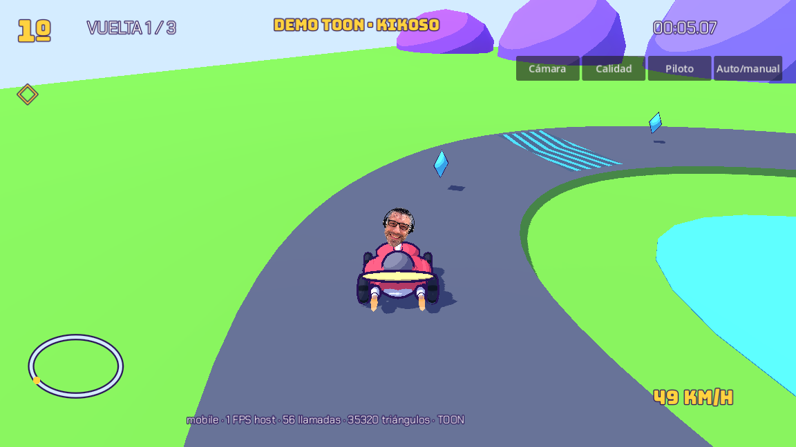
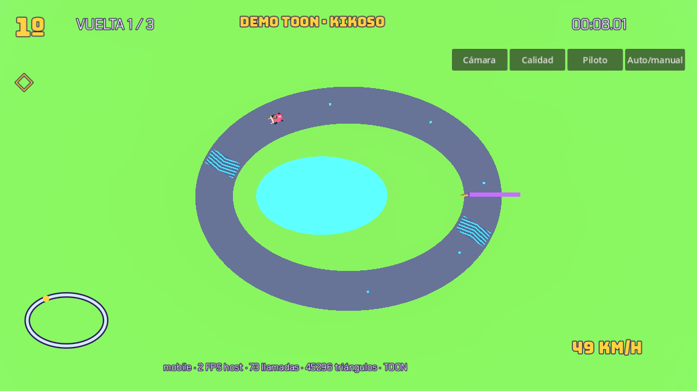
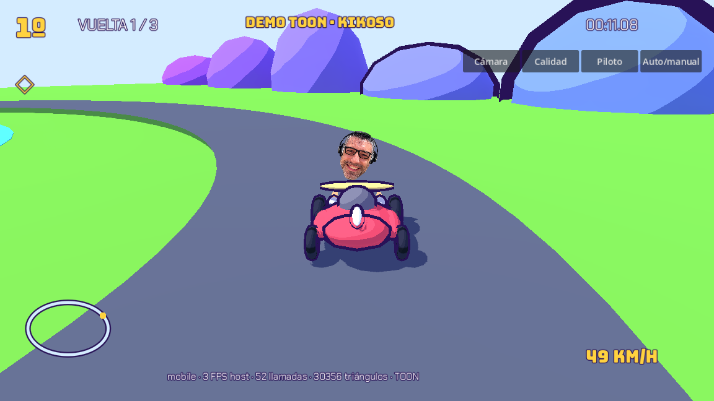

# MiniKarts: dirección toon combinada con el juego

Rama `art/toon-demo`. No cambia la versión publicada ni hace merge en main.

## Abrir y probar

Abre `godot/project.godot` en **Godot 4.5.1**, abre `res://scenes/toon_demo.tscn` y pulsa F6. No hay que crear nodos ni copiar código. En un ordenador compatible con Vulkan, `bash scripts/run-toon-demo.sh` inicia directamente el renderer Mobile. La demo incluye autoconducción, tres cámaras, selector de los 16 pilotos y calidad Bajo/Toon; Auto/manual permite usar W/A/S/D, B, Espacio y F. En móvil aparecen los controles existentes.

Para probar el juego combinado, ejecuta `res://scenes/main.tscn` (F5). Se conservan los 16 personajes/fotos/retratos, Jordan, los cinco circuitos y ambientes, rampas/agujeros, boosts de 80 km/h y cinco segundos, 3/6/9 vueltas, 16 corredores, IA, salas, torneo y podio. La carrocería ahora usa geometría original redondeada agrupada, ruedas con dibujo que giran, balanceo y rebote al aterrizar y llamas de escape. El casco chibi se ofrece en `res://scenes/toon/kart_prototype.tscn`, pero **en la carrera se mantiene la cara del amigo, sin casco genérico**. Los controles conservan joystick izquierdo, atrás/salto/disparo abajo a la derecha y freno arriba.

## Entrega

- `shaders/`: toon con tres muestras nearest y sombra incluida en la cuantización, contorno por next_pass, chevrones animados y escape aditivo.
- `materials/toon/`: carrocería, neumático, metal, piel, asfalto, hierba, agua, tronco y hoja; rampa original y dibujo del neumático.
- `scripts/toon_style.gd`: paleta, calidad, materiales compartidos, geometría estática agrupada por material/celda; no modifica colliders ni lógica de competición.
- `scenes/toon_demo.tscn`: escena estática persistida, carretera con subida/bajada, bordillos, arco original, lago, montañas, árboles/arbustos MultiMesh y ocho cristales propios.
- `scenes/toon_demo.lmbake` y `.exr`: horneado real de indirecta del escenario, generado en el editor Mobile. Sol con `BAKE_DISABLED`: sombras/luz directa solo en tiempo real, sin duplicarlas. No SSAO/SSR/SDFGI/VoxelGI.
- `scripts/toon_kart_visual.gd`: visual original sin alterar conducción o sincronización. `toon_safe_area.gd`: conversión de zonas seguras nativas.
- HUD existente: fuente Chakra Petch, puesto amarillo con Bungee, contorno morado, minimapa real situado por encima del joystick para no taparlo; vuelta/tiempo/velocidad siguen en la barra compacta que ya funcionaba. HUD de demostración con casilla de objeto y paneles separados.
- `assets/fonts/`: Bungee y Chakra Petch, con sus dos licencias OFL. No se requiere descargar modelos; créditos/licencias en `CREDITS.md` y `ASSET_LIST.md`.

Los contornos se apagan en Bajo y se atenúan a distancia. No hay contornos en pista, terreno ni agua. El decorado estático de los circuitos se agrupa para reducir llamadas sin eliminar sus cuerpos físicos.

## Compatibilidad y límites

Android usa el renderer Mobile; Web conserva Compatibility, necesario para WebGL. La demo se verifica con Mobile/Vulkan. La funcionalidad de los menús y el juego se comprueba además en Chromium/WebGL.

Medición Mobile en 1152×648 (visible + sombras + canvas): **48–75 draw calls y 23.506–45.852 triángulos** con Toon; **38–54 draw calls y 5.114–13.272 triángulos** con Bajo. Ambos quedan por debajo de 150 / 300.000 en la demo. FPS medidos en este host: 1–4 Toon y 2–4 Bajo durante la captura; no son cifras de un teléfono.

Las cifras de `docs/screenshots/toon-metrics.json` y `toon-low-metrics.json` provienen de llvmpipe en el entorno cloud, **no de un Android**. La medición suma geometría visible, sombras y canvas. El objetivo de 60 FPS requiere medir en un dispositivo real; no se promete rendimiento de hardware que no se ha probado.

Los cinco circuitos de carrera se generan en runtime. Por ello no se afirma que tengan LightmapGI horneado: mantienen luz ambiental y sol toon. La demo sí incluye bake completo. La transición de circuitos a escenarios estáticos horneables sería un trabajo posterior.

Los catálogos Kenney/Quaternius no fueron accesibles por la política de red; no se importa ni atribuye licencia CC0 a ningún pack no verificado. Todo el nuevo modelado se entrega originalmente, sin descarga pendiente. Las fotos del usuario no se presentan como CC0.

## Capturas

