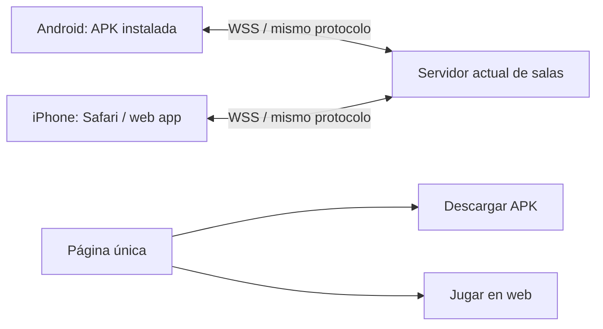

# MiniKarts — APK Android + Web iPhone

Fecha: 13/10/2026. Presupuesto: 0 €. Uso: aprendizaje y pruebas entre amigos, sin tienda.
Estado: plan y revisión delegada completados; APK y crossplay físico todavía pendientes.

## Decisión de producto

Una base de juego, dos clientes y un servidor común:

Sí pueden competir simultáneamente en una sala: la plataforma no tiene que ser igual. Deben coincidir protocolo, reglas, circuitos, estado de carrera y mensajes. No damos crossplay por probado hasta completar una partida mixta real. Perfiles gráficos y sensibilidad pueden diferir por dispositivo sin cambiar reglas.

Android: APK firmada compartida por web o archivo; sin Play Store. iPhone: Safari y añadir a inicio cuando el wrapper lo admita; no una app nativa ni APK en iPhone. No prometer funcionamiento offline: las partidas online requieren conexión.

## Punto de partida

Revisión Cloud del código: Godot 4.5.1; Web Compatibility; móvil Mobile. WebSocketPeer común. Export Android con INTERNET desactivado y package/signed=false. La URL nativa depende de variable de entorno, que normalmente no existe al instalar APK. No se ha identificado una negociación explícita de versión de protocolo; el preset Web tiene PWA desactivado. Añadir a inicio no demuestra aún una PWA completa ni modo offline. El plan debe resolver estos requisitos sin romper los clientes web existentes.

Comunicado del agente local, no comprobado directamente desde Cloud: ruta real joona; no hay kart final; Kenney-oobi provisional 2.000 × 1.365 × 0.943 m incluyendo ruedas, ejes/pivotes documentados. Cinco props y un material perfilados en Godot 4.5.1 Desktop Compatibility/Mobile; seis adaptaciones en local-assets/codex-optimized/. Los 221 SHA-256 coinciden y la carpeta de Claude sigue intacta. Pendientes: kart definitivo, atlas, AO, escena final y móvil físico. Un renderer Mobile en escritorio no valida un móvil.

La investigación de Claude comunica recursos CC0 en local-assets/claude-reactor/, ~107 MB de originales. No incorporar los 35 props de golpe ni tratar originales como presupuesto final de descarga/memoria. Revisar manifiestos locales y separar licencias comprobadas de pendientes. Quaternius permanece pendiente de aclaración de licencia.

Web29 es la versión habitual; prueba Motorsport separada. No sustituir la habitual con una copia local sin revisar diferencias, ni mezclar snapshots sobrescribiendo cambios.

## Prioridades y tareas asignadas

| ID | Prioridad / responsable | Tarea | Dependencia / cierre |
|---|---|---|---|
| D01 | P0 Codex local | Consolidar fuentes, ruta joona, informes de Claude y versiones | Inventario y diferencias respecto a Web29; nada sobrescrito |
| N01 | P0 Codex local/red | Endpoint WSS compartido, permiso INTERNET y conexión nativa | Conexión al servidor desde APK real; no variable de entorno del PC como único mecanismo |
| N02 | P1 Codex local/red | Versiones cliente/protocolo y manejo de incompatibilidad | Backend compatible primero; estrategia de clientes antiguos y rechazo comprensible cuando sea necesario |
| A01 | P0 Codex local/Android | SDK/JDK/templates de Godot 4.5.1, ABI y exportación | Herramientas gratuitas verificadas; primer APK instalable |
| A02 | P0 Codex local/Android | Firma estable de pruebas y versionCode creciente | Clave local fuera de Git, backup del usuario, actualización sin desinstalar |
| R01 | P0 Codex local/rendimiento | Instrumentación de fotogramas, red, carga y memoria accesible | Registros con plataforma/perfil/versión; separar render de jitter |
| R02 | P0 Codex local/rendimiento | Ahorro 30 FPS y perfiles conservadores | Cap medido por plataforma; resolución/sombras/efectos reducidos sin cambiar física |
| C01 | P1 Codex local/controles | Sensibilidad, zona muerta, curva, suavizado, presets y reset | Guardado por dispositivo y multitouch; entrada procesada común para cliente y servidor |
| R03 | P1 Codex local/rendimiento | Calidad automática con histéresis y límites | Reducir carga ante caída sostenida, no oscilar cada segundo; opción manual |
| W01 | P1 Codex local/web | Safari, audio, orientación, safe areas y ciclo de vida | Pruebas iPhone físico y modo pantalla de inicio; no paneles/entradas retenidas |
| Q01 | P1 Usuario/amigos + Codex local QA | Partida APK + iPhone Safari en misma sala | Carrera mixta completa de 15min, reglas y acciones correctas |
| V01 | P2 Codex local/arte técnico | Elegir kart final, comparar modelos y optimizar props | Licencias/importación, capturas reales; no bloquea primera APK funcional |
| V02 | P2 Claude arte | Construir estructura garaje/Reactor modular | Solo local-assets/claude-architecture/; fuentes .blend, GLB y UV/escala verificadas |
| V03 | P2 Codex local/arte técnico | Garaje 3D + tramo Reactor, atlas/AO/LOD | V01/V02; escena aislada que alcanza calidad y presupuesto medido |
| Q02 | P2 QA + usuario | IA, torneo/podio, 3/6/9 vueltas y 16 jugadores | Crossplay 1/8/16 y regresiones con arte elegido |
| P01 | P3 Codex local/entrega | Página única web/descarga, versión e instrucciones | A02/Q01; APK candidata identificada y SHA-256; publicar tras autorización |

Dos líneas paralelas: producto estable/fluido (N/A/R/C/W/Q) y muestra artística (V). No añadir detalle caro a la versión habitual antes de medir. Música sigue aplazada.

## Equipo y coordinación

Agentes Cloud ya asignados para revisión: Android/crossplay; rendimiento/controles; coordinación de entregas. Su acceso es al repositorio Cloud, no al Windows ni a Claude local.

Codex local lidera implementación, exportación e integración en joona. Si puede delegar, separar red/Android, rendimiento, controles y QA con responsables de archivos; evitar ediciones simultáneas del mismo archivo. Usar el checkout/copia existente; no crear worktrees innecesarios.

Claude local se ocupa del arte/arquitectura, originales y manifiestos en sus carpetas exclusivas. No modifica godot/, export, red ni carpetas de Codex. Ajustar plataforma a medidas provisionales mientras falta kart final y registrar ese supuesto. Cualquier dependencia entre agentes se transmite por informe, no por asumir acceso automático entre aplicaciones.

Usuario/amigos prueban teléfonos reales y revisan calidad. Este chat coordina con informes que se copian o adjuntan: no puede comprobar automáticamente los archivos del portátil.

## Rendimiento y temperatura

Partir conservador. Ahorro: objetivo 30 FPS y menor resolución, sombras, partículas, decoración distante y efectos. Equilibrado: 30 FPS con detalle aprobado; Calidad puede ofrecer 60 si el equipo sostiene la carga. Verificar que el limitador funciona en Web; un valor configurado no demuestra el cap. No cambiar tick de física, velocidades, cooldowns ni tick de servidor por reducir render.

Automático: medir tiempos de fotograma, bajar resolución/efectos escalonadamente ante caída sostenida; restaurar más lentamente tras recuperación y nunca por encima de lo elegido. Mantener texto/HUD y obstáculos legibles. El intervalo de fotogramas incluye la espera del cap: no interpretar 33.3ms de un juego limitado a 30FPS como carga excesiva ni bajar calidad continuamente por ello. Comparar con el presupuesto de ese perfil y usar coste de trabajo disponible o incumplimientos sostenidos. Evitar recompilar shaders y recrear escenas durante la carrera; si un ajuste exige recarga, aplicar en menú e informarlo.

Objetivos iniciales propuestos: perfil estable de 30 FPS, p95 ≤40ms en teléfono de referencia; registrar p50/p95/p99 y frames >50/100ms. La prueba dura 15min, no solo el primer minuto. Medir al comienzo y al final, sin cargar el teléfono para la comparación térmica. Registrar modelo/SO/calidad/resolución y condiciones. No garantizar temperatura baja ni 60 FPS universal.

Android puede consultar señales térmicas con integración/plugin si aporta valor; no es requisito de la primera APK. Safari no da acceso equivalente fiable a temperatura: adaptarse con rendimiento observable. No confundir FPS bajo con lag de red; anotar RTT/jitter/buffers/desconexiones por separado. Mantener Render actual gratis; no cambiar a servidor de pago ni prometer latencia fija del servicio Free.

## Controles personales

Ajustes: sensibilidad de dirección, zona muerta, curva progresiva y suavizado opcional; tamaño de joystick si el layout lo permite. Presets Suave/Equilibrado/Directo/Personalizado; probar y restablecer. Guardar con límites/versionado y sanitizar valores al cargar.

Interpretar el joystick antes de enviar intención al servidor y usar el mismo resultado en predicción local. No aumentar giro físico, velocidad o grip para un jugador. El kart ya suaviza con Handling: evitar doble suavizado y medir latencia de control. Reiniciar filtros al perder foco, cambiar de fase, pausar o cancelar toques. Mantener cinco contactos simultáneos y botones más grandes de salto/disparo. Test de centro, borde, inversión brusca, dos dedos en un botón, cancelación y suspensión.

## Pruebas de juego cruzado y aceptación

| Prueba | Dispositivos / criterio |
|---|---|
| APK anfitrión, Safari invitado | Crear, listar, unirse, listos, cuenta atrás y carrera completa |
| Safari anfitrión, APK invitado | Mismas acciones; no privilegios por plataforma |
| Compatibilidad | Misma versión, cliente antiguo frente a candidato y rechazo/migración explícita; web en caché |
| Jugabilidad | Giro/salto/disparo/boost/rampa/respawn, vueltas y orden de resultados coherentes |
| Ciclo de vida | Cambio de app, bloqueo pantalla, orientación, desconexión/anfitrión; no controles pegados |
| Carga | 1/8/16 corredores, efectos activos y torneo; no inferir 16 físicos de una prueba de dos móviles |
| Térmico | 15min APK Android; comparar web en ese Android; 15min Safari iPhone |
| Instalación | APK fresca y actualización con misma firma; datos/ajustes conservados |
| Web app | Safari pestaña y añadir a inicio por separado; audio solo después de interacción |
| Visual | Capturas del juego real: mismos modelos/colliders, perfiles diferentes; personajes reconocibles |

El crossplay inicial pasa con dos móviles reales; la capacidad 16 requiere además prueba representativa de carga. Aprobación final incluye recursos gratuitos correctamente acreditados, QA funcional, mejora medible sin regresión y aceptación visual del usuario.

## Descarga y actualizaciones

Página única con Jugar en navegador y Descargar Android; versión, tamaño, hash y guía corta. Se puede alojar APK gratuitamente (p. ej. GitHub Releases) y enlazarlo desde la web, verificando límites de tamaño del proveedor; una descarga pequeña de APK no implica descarga inicial pequeña de todos los recursos.

Firma de pruebas gratuita y estable, no Play Store ni Apple Developer. Keystore/contraseñas nunca en repositorio, ZIP de traspaso, APK ni informes. Mantener respaldo local del usuario. Sin misma firma, la actualización puede obligar a desinstalar: no rotar clave casualmente. Firmar APK distribuida y mantener packageId/versionCode. Web se actualiza en el enlace; APK requiere instalar versión nueva. Mostrar incompatibilidad antes de permitir una partida si los protocolos divergen. Evitar actualizadores/instalación silenciosa.

## Estado y siguiente acción

Plan listo; implementación aún no iniciada aquí. El resumen local se incorpora como evidencia comunicada y debe contrastarse con informes locales. Primera acción: D01/N01/A01/R01; Claude continúa V02 en paralelo. No comprar, activar API de pago, migrar motor ni publicar por este plan. No prometer calendario antes de resolver exportación/crossplay y medir en teléfonos.

Al terminar cada tarea: ID, COMPLETADA/BLOQUEADA/PENDIENTE, archivos, pruebas realmente ejecutadas, límites y próximo destinatario en docs/local/ESTADO_PARA_CHATGPT.md. Conservar registros; no repetir baterías enteras cuando los cambios solo exigen comprobaciones puntuales.
